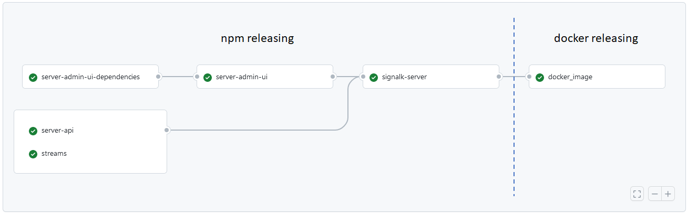

# Releasing a new server version

## One-time setup

The `signalk-server` package must trust `.github/workflows/release.yml` as an npm
OIDC publisher and allow `npm stage publish`.

Create a GitHub Environment named `npm-release` and configure its deployment
protection rules with the required release reviewers. The release workflow uses
this environment to pause after npm staging. Without required reviewers, the
workflow will not wait for npm approval.

## 1. Update package versions

Update the `package.json` files for changed packages under `packages`, their
internal dependants, and the root package as needed.

Published npm packages include:

- `@signalk/server-admin-ui-dependencies`
- `@signalk/server-admin-ui`
- `@signalk/server-api`
- `@signalk/streams`
- `@signalk/path-metadata`
- `@signalk/resources-provider`
- `signalk-server`

## 2. Create the server version

```shell
npm version major | minor | patch
```

This updates the root `package.json`, commits the change, and creates the version
tag.

For a prerelease, specify the full version:

```shell
npm version 2.36.0-beta.1
```

Prerelease versions must contain `beta`; the release workflow assigns those
versions the npm `beta` dist-tag instead of `latest`. Check the current tags in
the [npm registry](https://registry.npmjs.org/-/package/signalk-server/dist-tags).

## 3. Push the commit and tag

```shell
git push
git push --tags
```

The release workflow builds the repository, directly publishes changed workspace
packages, and submits `signalk-server` to npm's staging area. The staged server
version is not publicly installable yet. The workflow then waits at the
`npm-release` environment.

## 4. Review and approve the npm package

Review the package in the **Staged Packages** tab on npmjs.com, or use the npm
CLI:

```shell
npm stage list signalk-server
npm stage view <stage-id>
npm stage download <stage-id>
npm stage approve <stage-id>
```

Approval requires npm two-factor authentication. Reject an invalid package with
`npm stage reject <stage-id>`.

## 5. Continue the release workflow

After npm approval, approve the pending `npm-release` deployment in GitHub
Actions. Approve npm first: the gated job verifies that the exact version from
the repository's root `package.json` is publicly available before continuing.

The remaining jobs:

- create the GitHub Release
- build release images by installing the verified version from npm
- publish the multi-architecture images to GHCR and Docker Hub
- deploy the version to [demo.signalk.org](https://demo.signalk.org/)

Docker images therefore contain the same public npm package users install. Final
version and `latest` image tags are not published before npm approval.


